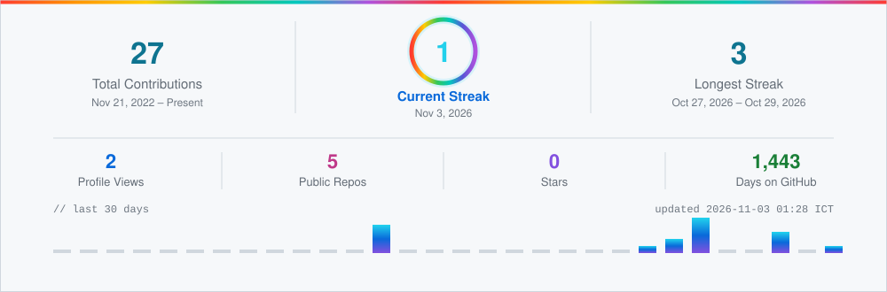
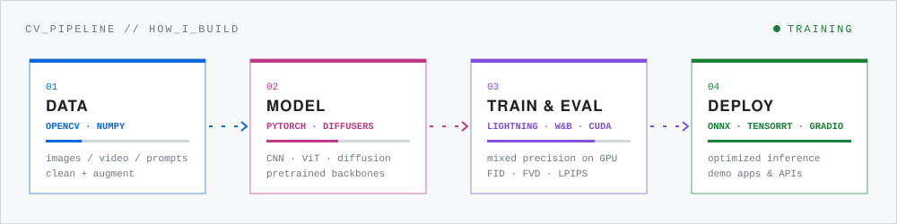
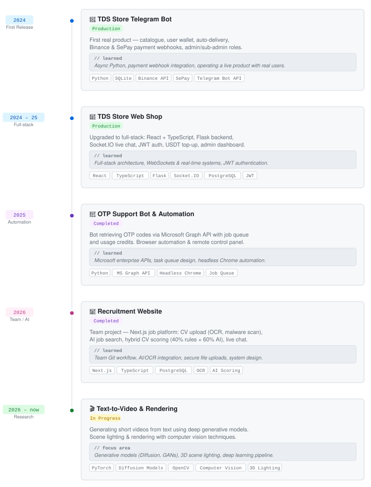

  

  

# **ABOUT ME**

  

# **GITHUB ACTIVITY**

  
  <!-- hidden: keeps the komarev view counter ticking; the number is shown in streak.svg -->
  

  <picture>
    <source media="(prefers-color-scheme: dark)" srcset="https://raw.githubusercontent.com/daksdlkask26/daksdlkask26/output/github-snake-dark.svg">
    
  </picture>

# **TECH STACK**

<table>
  <tr>
    <td><b>Languages</b></td>
    <td>   </td>
  </tr>
  <tr>
    <td><b>Computer Vision</b></td>
    <td>  </td>
  </tr>
  <tr>
    <td><b>Deep Learning</b></td>
    <td>   </td>
  </tr>
  <tr>
    <td><b>Generative & 3D</b></td>
    <td>  </td>
  </tr>
  <tr>
    <td><b>MLOps & Deployment</b></td>
    <td>     </td>
  </tr>
  <tr>
    <td><b>Web & Backend</b></td>
    <td>    </td>
  </tr>
  <tr>
    <td><b>Databases</b></td>
    <td> </td>
  </tr>
  <tr>
    <td><b>Tools</b></td>
    <td>   </td>
  </tr>
</table>

# **HOW I BUILD**

  

# **CONTACT**

Happy to talk about computer vision, generative models, or anything I've built here.

  
  
  
  

# **MY BUILD JOURNEY**

